# LIBRERÍA DE TIENDA DE ÚTILES ESCOLARES UTIL HOME

Util Home es una aplicación web que permite gestionar el stock, las marcas y los útiles de escritorio, así como comprar online a los clientes.

## Features

- Dashboard para administrador que permite hacer un CRUD completo de marcas, categorías, productos y precios
- Registro e inicio de sesión
- Carrito de compras.
- Pasarela de pago simulada.
- Registro de dirección de envío.
- Sección de pedidos realizados

## Tech Stack

**Frontend:** Bootstrap 4, Razor y Ajax.

**Backend:** Visual Studio, ASP.NET MVC, SQL Server Management Studio.

## Instrucciones de uso

- Ir a https://github.com/PatrickMandujano/LIBRERIA-UTIL-HOME---TIENDA-UTILES-DE-ESCRITORIO/tree/main/Utilidad/SQL%20Server

- Ejecutar en SQL Server Management Studio los scripts de los archivos en el siguiente orden: Creación Base de Datos, Insertar Ubigeo, Insertar Datos y finalmente Procedimientos.

- Abrir carpeta de proyecto en Visual Studio y ejecutar proyecto desde la vista Index.cshtml que se encuentra en la carpeta Login dentro de Views. La tabla USUARIO ya tiene las credenciales de dos usuarios, uno administrador y otro cliente.

- Capturas del dashboard del administrador:
     
    LOGIN
     
    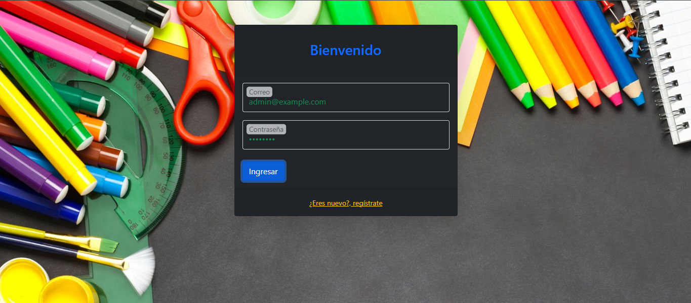
     
     
    Menú principal
     
    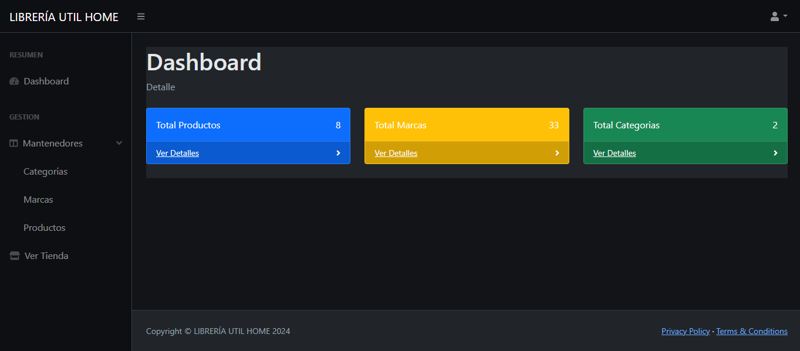
     
     
    Panel categorías
     
    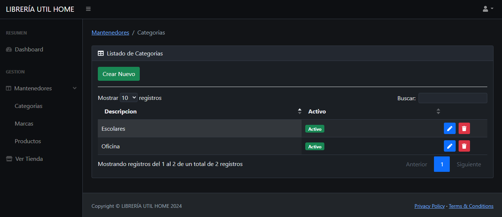
     
    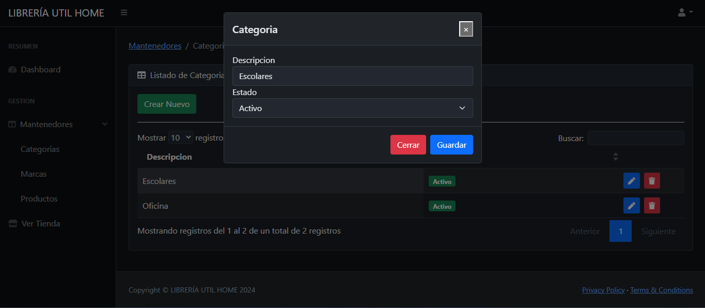
     
     
    Panel marcas
    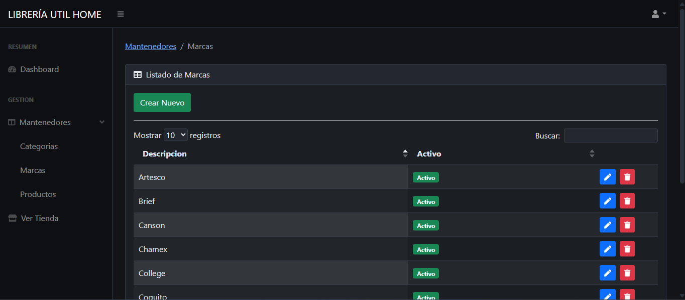
     
    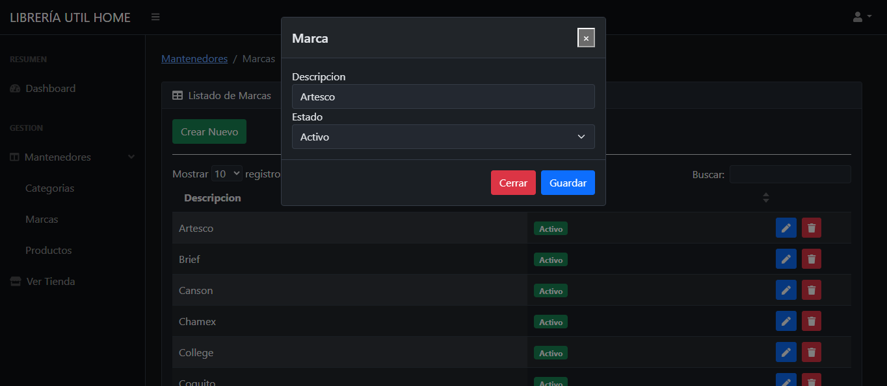
     
     
    Panel productos
     
    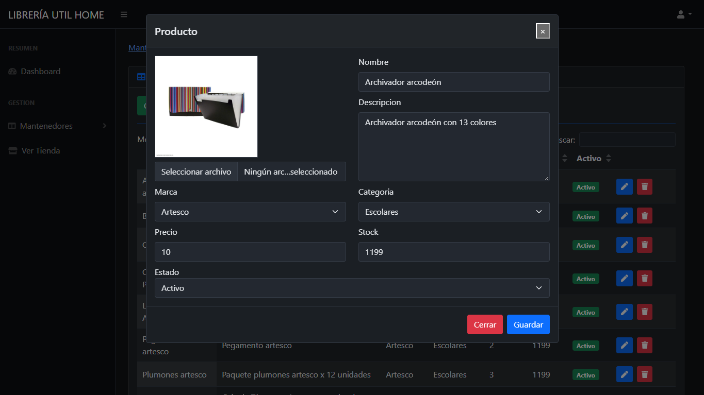
     
     
     
    Capturas de acceso para los clientes:
     
     
    Crear cuenta
    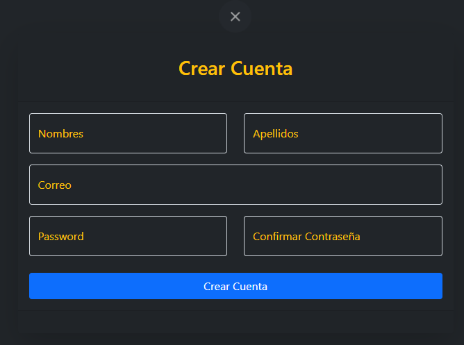
     
     
    Menú principal
    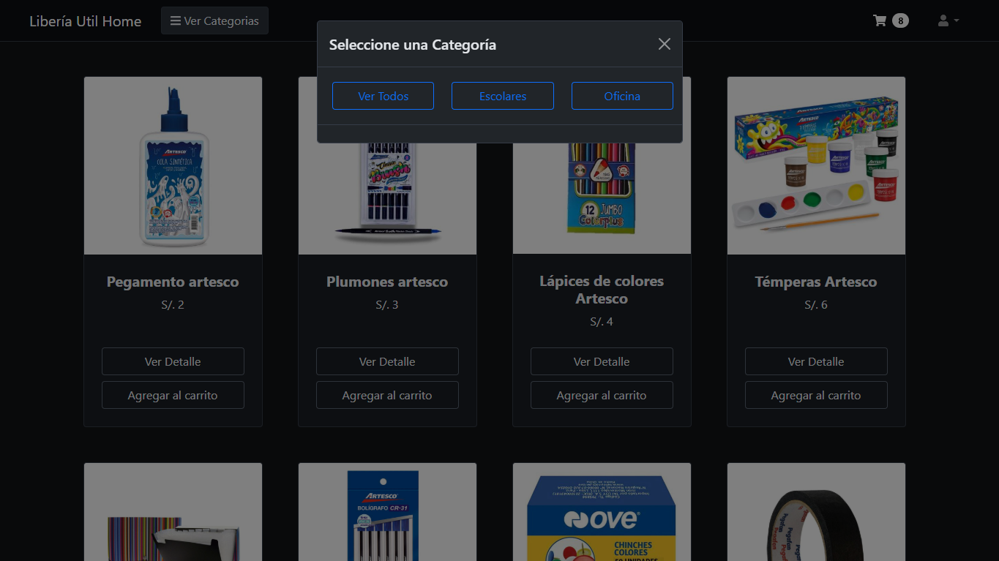
     
     
     
    Carrito de compras
     
    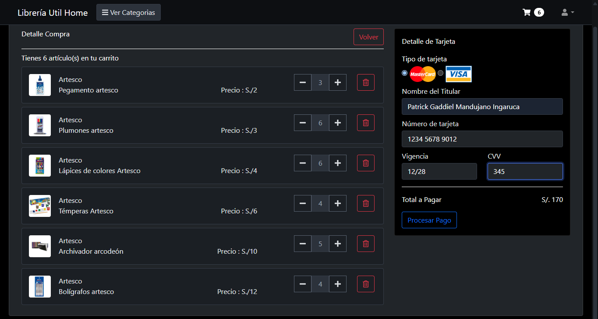
     
    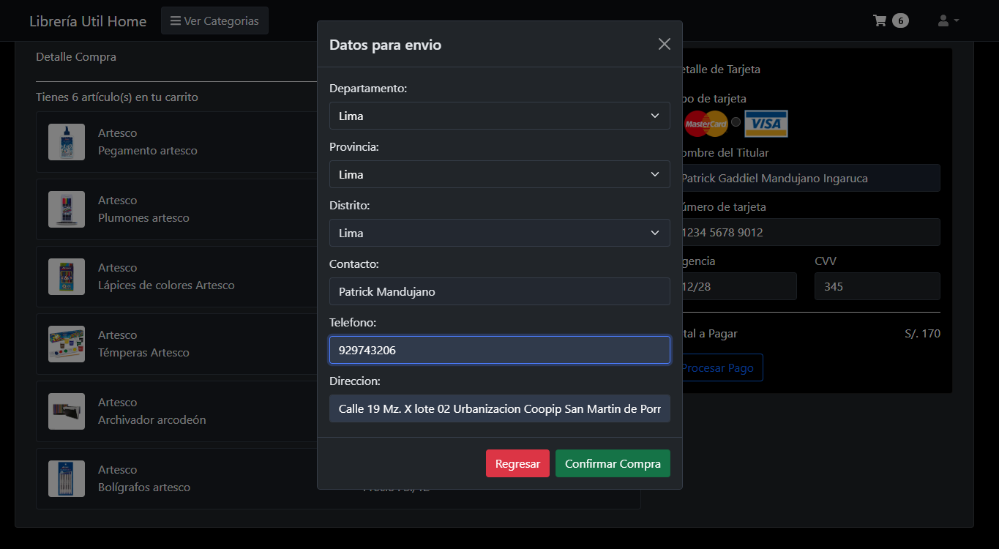
     
    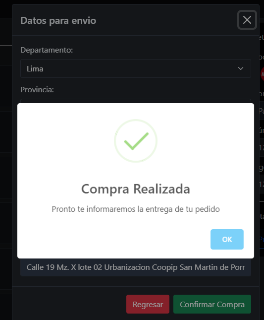
     
     
    Compras realizadas
     
    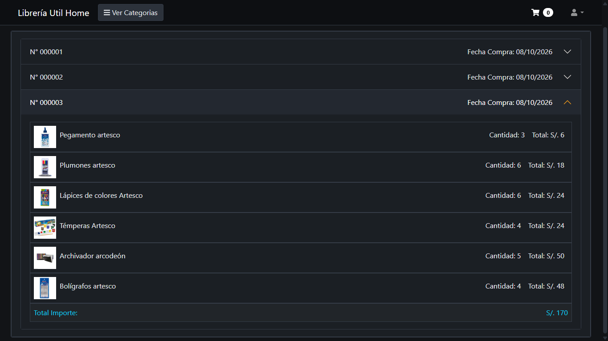

